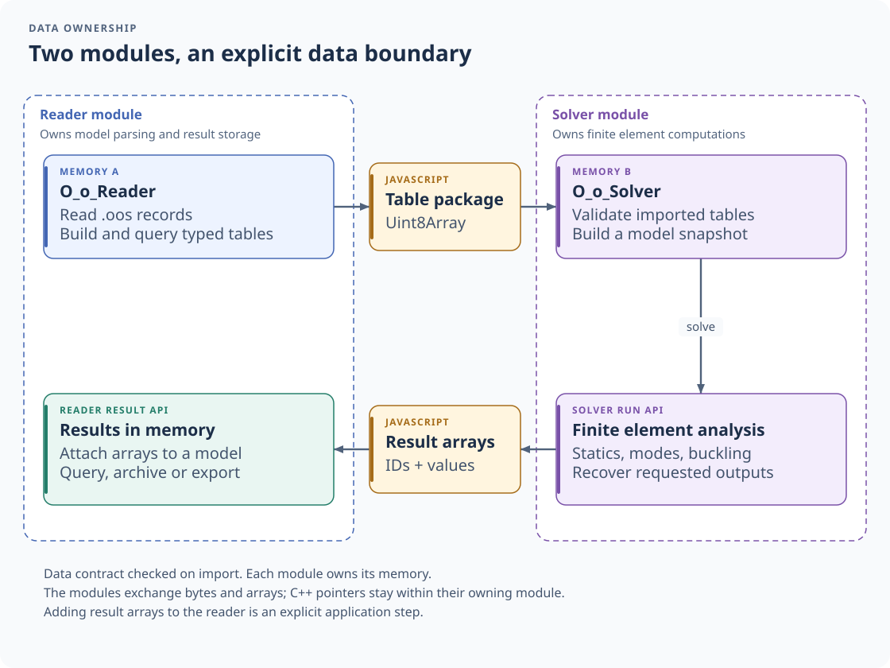
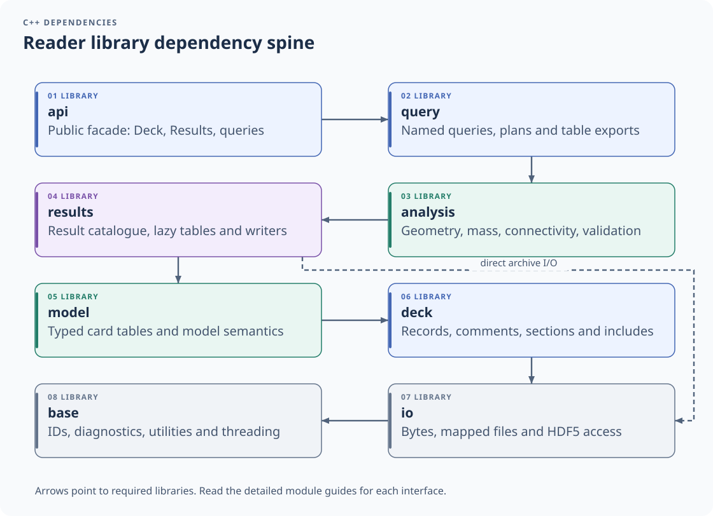
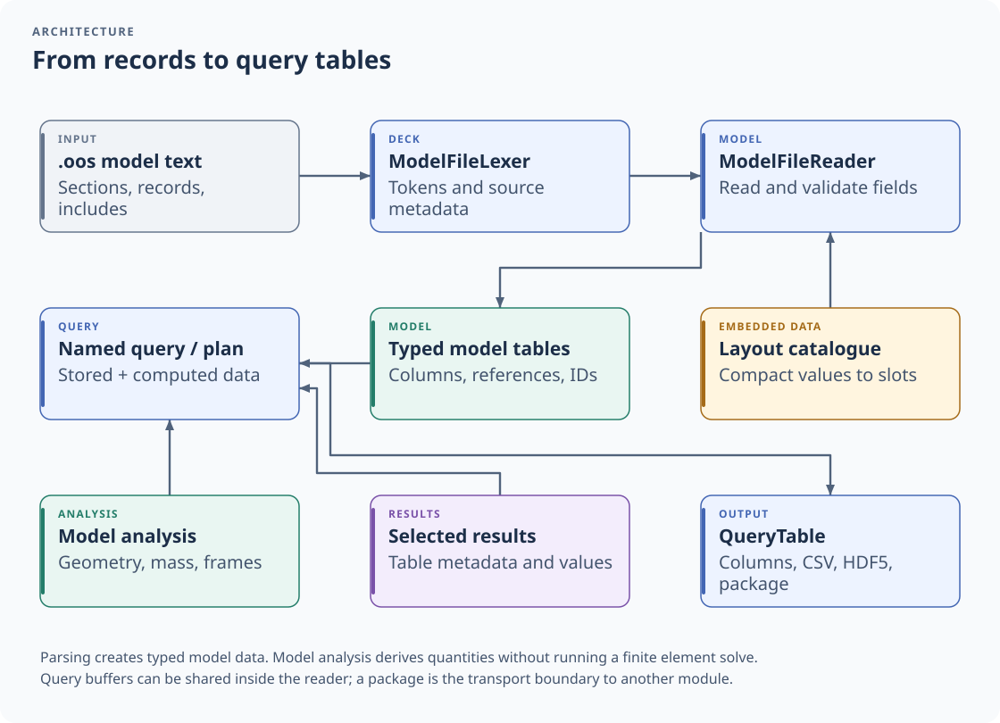
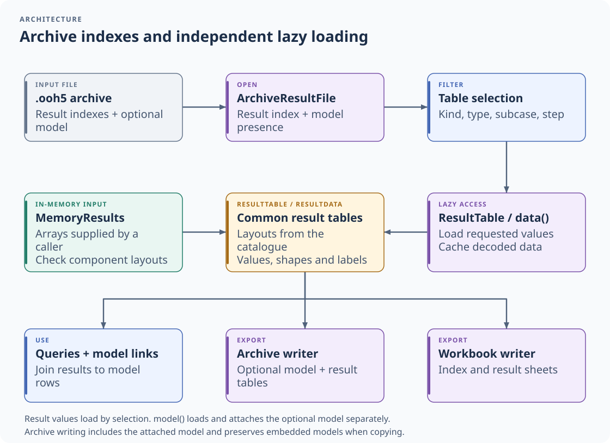

# Architecture

A guide for a developer who joins the project: where things are, how they fit, and where to start reading.

## Reader and solver boundary

*The reader owns parsing, model queries and result storage. The solver owns finite element computations.*

The application loads each module independently. A query table becomes a byte package through `toPackage()`;
the receiving module imports that package and checks its data contract. A C++ pointer stays in the memory that owns
it. The [table-package guide](table-package.md) describes the transport and retained ownership.

The solver returns result arrays. The application may explicitly add them to the reader's `MemoryResults`, attach
them to a model and use the same query and export APIs as for file-backed results. The
[solver architecture guide](https://jcdulas.github.io/O_o_Solver/docs/architecture.html) follows the calculation side.

## The modules

The library is a stack of static libraries. A module uses only the modules below it (`tools/check_layering.py`
checks it), so each can be read and tested on its own.

| Module | Namespace | What it does | Start reading at |
| --- | --- | --- | --- |
| `base` | `oor::base` | diagnostics, errors, IDs, number parsing and formatting, small math, a thread pool | `diagnostics/Diagnostic.hpp` |
| `io` | `oor::io` | reading bytes, memory-mapped files, the HDF5 layer (the only code that includes libhdf5) | `hdf5/Hdf5Writer.hpp`, `hdf5/Hdf5Table.hpp` |
| `deck` | `oor::deck` | model records, comments, Include files, source metadata and staged file writes | `records/ModelFileLexer.hpp` |
| `model` | `oor::model` | the model: one typed table per card type (column storage), the control sections, reading and writing | `core/Model.hpp`, `core/ModelFileReader.hpp` |
| `results` | `oor::results` | native model/results archives, lazy result tables, the result catalogue, the Excel workbook | `archive/ArchiveModel.hpp`, `core/ResultTable.hpp` |
| `analysis` | `oor::analysis` | geometry, coordinate frames, mass, sections, laminates, mesh quality, adjacency, components, validation checks | `geometry/ElementGeometry.hpp` |
| `query` | `oor::query` | the query engine (plans, columns, expressions), the named queries, CSV and HDF5 exports | `named/NamedQueryRegistry.hpp` |
| `api` | `oor::api` | the simple entry points used by the WebAssembly module: `Deck`, `Results`, `runQuery` | `Deck.hpp`, `Results.hpp`, `Queries.hpp` |

The WebAssembly module (`wasm/src/Bindings.cpp`) only converts JavaScript values to the types of `oor::api` and back.

*Arrows point to directly required libraries. The extra storage link lets result readers and writers use `io`.*

## How a model is read

*Text records and native archive columns populate the same model. Model analysis derives quantities for queries.*

A model file (`.oos`, [model-format.md](model-format.md)) writes a card as one record in a compact order. The card
layout catalogue (`formats/oos-layouts.json`, compiled into the library) maps each record field to the internal slots
used by its typed card reader. `model::ModelFileWriter` turns the slots a card writer fills back into a record. These
slots are described in the layout catalogue; public card APIs use the compact record order and exact neutral names.
The native archive freezes their meaning as a versioned binary model schema and includes the catalogue for independent
readers. A change to that binary slot contract requires a new model schema version.

The catalogue is generated by `tools/oos_layouts/` and listed card by card in
[model-format-cards.md](model-format-cards.md). Each card type has a folder `src/model/cards/<family>/<card>/` with its
table and a card struct in `include/oor/model/cards/<family>/<card>/`. The registry is `src/model/cards/AllCards.cpp`.

`api::Deck::readModel` also recognizes `.ooh5` archives by content. The archive model reader lives in `results/archive`
so the `model` module remains independent of archive storage. It rebuilds the same card tables through `FieldReader`
using typed fields, avoiding numeric text conversion. The archive lists result tables without loading the model;
`Results::model()` loads and attaches it on demand. See [the archive specification](archive-format.md#native-model).

## How results are read

*Metadata selection precedes value loading. The result catalogue supplies the component layouts shared by the input
paths and writers.*

- **`ResultCatalogue`** (`results/core/ResultCatalogue.hpp`, data in `ResultCatalogueData.cpp`) says which components a
  table of each kind and element type has. Every reader, writer and table made in memory uses it, so a ShellQuad4 stress
  table has the same columns whatever file it came from.
- **The archive** (`results/archive/`): `ArchiveWriter.cpp` writes tables as they are pushed (a session), then the
  index; `ArchiveModel.cpp` writes optional native model columns at session creation. `ArchiveResultFile.cpp` reads the
  result index at once and table values step by step, when asked. The facade's `Results::model()` loads and attaches
  the embedded model separately and caches its deck. Writes include the attached model, or preserve the embedded one
  before it has been loaded. The format is described in [archive-format.md](archive-format.md).
- **The Excel workbook** (`results/xlsx/XlsxWriter.cpp`, an output only): an index sheet with links, one sheet per
  table (a line per step and row, a column per component), split past Excel's row limit. The ZIP container is
  `io/zip/Zip.cpp` (zlib); the XML of the sheets is written by hand, with no third-party library.
- **Tables made in memory** (`results/core/MemoryResults.hpp`): how a program hands results to the library.

## Model construction and editing

The [construction API](model-construction.md) has three responsibilities. The JavaScript adapter in
`wasm/js/model-editing.js` maps named objects through the cached compiled card catalogue and offers lightweight
case-section handles. `wasm/src/ModelEditingBindings.cpp` converts objects and typed arrays, returning owned snapshots.
`api/CardEdits` and `api/ControlEdits` validate batches and edit the existing native model structures. C++ tests exercise
that domain logic independently of JavaScript.

Fixed-layout card batches enter typed field readers without decimal conversion. Identifier indexes and column
capacity are reserved by batch. All card rows are validated before IDs are registered; failed temporary rows remain
invisible tombstones. A successful replacement calls the table's `store` function, retaining the original key and row,
and tombstones its temporary input row. It does not rebuild the rest of the table. Explicit compaction reclaims dead
rows while retaining keys. Copy-on-write buffers remain snapshots when a model or query shares them.

Case edits use the same command catalogue, value checks and inheritance rules as model input. Card data and control
data have independent revision counters. Full control replacement assigns fresh keys; small edits retain section
identity. Part decks alias the owning root's shared pointer, keeping their models alive without raw JS pointers.

## How a query runs

A named query (`src/query/named/<family>/<query>.cpp`, one class each) receives the model, the result sets and its
arguments (`QueryRun`), and returns a `QueryTable` (columns that share their buffers). The columns of the cards
("id", "xyz" of a Node) come from the `StoredColumnCatalogue`, filled once by `src/query/providers/columns/` (one file
per family of cards).

Stored columns and computed quantities feed the same table interface. Buffers can be shared within the reader.
Exporting a table package is the explicit transport step to an independently loaded module; it preserves the column
layout and metadata rather than exposing the reader's memory.

## Conventions

- C++20, the subset GCC 12 supports; `-Wall -Wextra -Wpedantic -Werror` natively.
- Names: types and enum values `CamelCase`, functions and variables `camelCase`, members `m_name`, constants
  `UPPER_CASE` (`.clang-format`: 4 spaces, 120 columns, braces on their own line).
- Errors are exceptions (`base/errors/Errors.hpp`): `IoError` (a file cannot be read), `DeckError` (a model is wrong, in
  strict mode), `UsageError` (a caller gave something that makes no sense), `EmptySelectionError`, `QueryError`.
  Problems that do not stop the work are diagnostics, kept with what they are about.
- Everything is written in English. Comments say *why*; the code says *what*.
- WebAssembly: 64-bit (Memory64) and one thread; the thread pool has zero workers there and runs everything on the
  calling thread.

## Tests

- `tests/cpp/<module>/`: one Catch2 executable per module; each test case is a ctest test. They run natively only.
- `wasm/test/*.test.mjs`: the WebAssembly package and structured model-construction API end to end, in Node.js.
- The tests of the archive and the workbook (`tests/cpp/results/ArchiveTest.cpp`, `XlsxTest.cpp`) write tables and
  read them back (the workbook through `io::readZip`).
- `tests/cpp/results/ArchiveModelTest.cpp` sends the main validation models through native columns and compares card
  tables and exported `.oos` text. It also checks exact values, source precision, parts, keys and pending defaults.
  API and WebAssembly cases cover model-only, result-only and combined archives, including copying an unloaded model.

The diagrams are committed SVG images. See the [documentation maintenance guide](documentation.md#architecture-images)
for their editable specifications and regeneration command.
